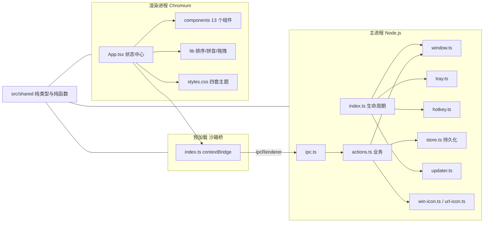
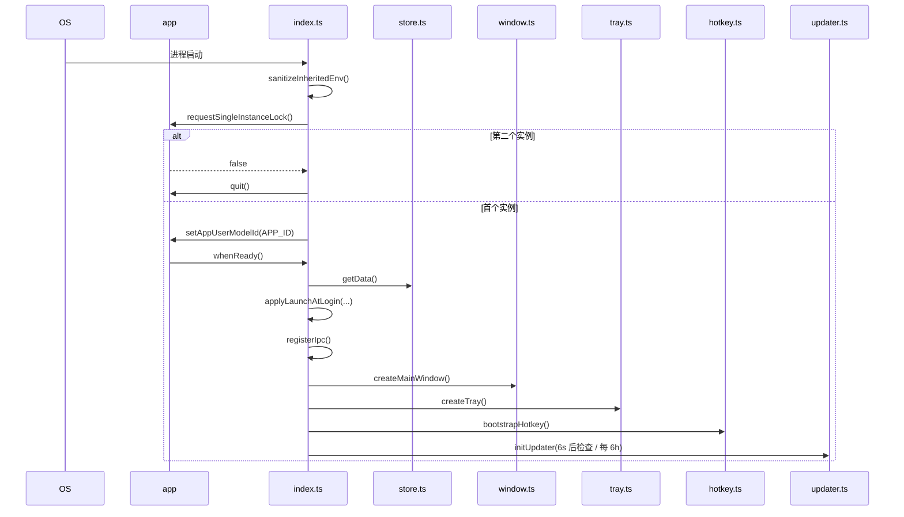
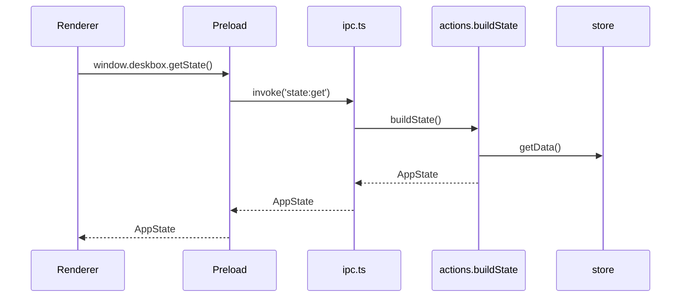
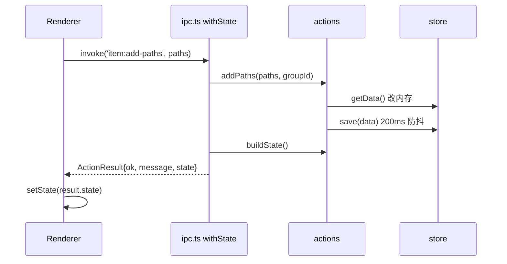
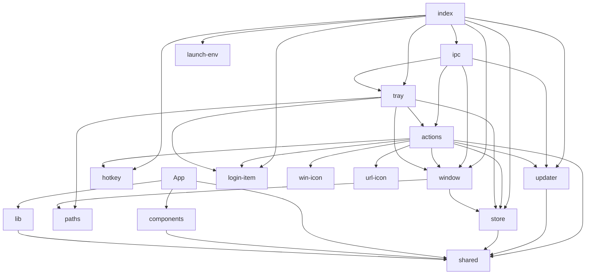

# 01 · 整体架构

## 1. 进程模型

desk-box 使用 Electron 标准三进程模型，并额外抽出一层纯 TypeScript 共享代码。



### 各层职责

| 层 | 目录 | 职责 | 禁止事项 |
| --- | --- | --- | --- |
| 主进程 | `src/main/` | 窗口、托盘、快捷键、持久化、系统调用、更新 | 不写 UI |
| 预加载 | `src/preload/` | 把 IPC 包装成 `window.deskbox` | 不写业务逻辑 |
| 渲染层 | `src/renderer/` | 全部界面、交互、派生数据 | 不直接访问 Node/Electron |
| 共享层 | `src/shared/` | 类型、默认值、纯函数、IPC 常量 | 不引用 `electron` / `react` |

共享层之所以必须纯净：`tsconfig.node.json` 与 `tsconfig.web.json` 都 include `src/shared/**/*`，一旦引入 Electron 类型，渲染侧编译会失败。

---

## 2. 启动时序

入口：[src/main/index.ts](../src/main/index.ts)



关键顺序与原因：

1. **先清理环境变量**（`sanitizeInheritedEnv`）：避免被打开的子进程带着 `ELECTRON_RUN_AS_NODE`、`NODE_OPTIONS`、`WORKBUDDY_*` 等启动上下文，导致白屏。
2. **单实例锁**：第二次启动不新建进程，只触发 `second-instance` 把已有窗口叫出来。
3. **先注册 IPC，再建窗口**：渲染层加载后立即可以 `getState()`。
4. **更新器最后初始化**：状态需要广播给已存在的窗口。

退出链路（`before-quit`）：

```ts
setQuitting(true)   // 让 close 事件不再拦截
flushBounds()       // 立即写窗口位置
flushNow()          // 立即写待落盘数据
unregisterHotkey()
disposeUpdater()    // 清掉 6s / 6h 定时器
```

`window-all-closed` 刻意留空：关闭窗口只隐藏，托盘常驻。

---

## 3. 状态与数据流

### 3.1 读路径



`buildState()` 会为每个条目派生 `ext`、`exists`、`linkDir`，并完成一次全局排序。派生字段不落盘。

### 3.2 写路径（渲染层发起）



`withState` 统一包装：

- 成功：`{ ok: true, message?, cancelled, state }`
- 失败：捕获任何异常 → `{ ok: false, message, state }`
- 原生对话框取消：返回 `{ cancelled: true }`，界面据此不清空选择。

### 3.3 推路径（主进程发起）

托盘菜单、全局快捷键、右键菜单等由主进程直接改数据，然后调用 `pushState()`：

```ts
win.webContents.send('state:changed', buildState())
```

渲染层通过 `window.deskbox.onStateChanged` 订阅。更新状态则走另一条通道 `update:changed`。

---

## 4. 模块依赖图



依赖原则：

- `actions.ts` 是主进程的业务中心，其他模块（`tray` / `ipc`）只做入口转发或 UI。
- `store.ts` 不感知业务，只负责“读缓存 / 改后落盘”。
- `window.ts` 只关心窗口，不执行业务。
- `updater.ts` 通过 `UpdateOptions` 回调注入外部依赖，避免反向 import `window`/`store`。

---

## 5. 安全边界

| 配置 | 值 | 说明 |
| --- | --- | --- |
| `nodeIntegration` | `false` | 渲染层不能 `require` |
| `contextIsolation` | `true` | preload 与页面上下文隔离 |
| `sandbox` | `false` | preload 需要 `webUtils`、`ipcRenderer` 等 |
| CSP | 见 [index.html](../src/renderer/index.html) | `default-src 'self'`；图片允许 `data:`（图标 data URL） |
| 外链白名单 | `http/https` | `ipc.openExternal` 显式校验协议，防止 `file://` 拉起本机程序 |
| 路径失效 | `exists` 派生 | 失效项显示红色虚线框，打开时给明确错误 |

需要特别注意的是：CSP 中允许 `style-src 'unsafe-inline'` 与 `script-src 'unsafe-inline'`，这是为了让 Vite 注入样式和 React 正常运行；但没有放开 `connect-src` 到任意域。

---

## 6. 关键设计决策详解

### 6.1 一切写操作都返回最新状态

`ActionResult` 同时携带 `state`，渲染层不用“改完再查一次”。这让批量操作、对话框取消、错误提示都能在一个对象里表达。

### 6.2 批量操作合并为单次 IPC

`updateItems` / `removeItems` / `openItems` / `reorderItems` 都只触发一次落盘、一次状态推送。逐条调用在选中二三十项时会造成大量界面闪烁与重复磁盘写入。

### 6.3 排序的“座位”算法

`reorderItems` 不直接重排全库，而是：

1. 按当前全局顺序找到这批条目占住的位置（座位）。
2. 按用户拖出的新顺序，把条目依次填回这些座位。
3. 最后整库重编号为 `0..n-1`。

好处：不会把未参与排序的条目挤到别处；同时顺手修复老数据 `order` 全为 0、无法插入的问题。

### 6.4 「常用」虚拟分组

`FREQUENT_ID = 'freq'` 只存在于渲染层的筛选逻辑中，不落盘、不可重命名/删除。`openCount > 0` 的条目按打开次数降序取前 10 个。

### 6.5 图标策略

- 仅 `lnk` / `exe` / `url` / `ico` 尝试系统图标。
- 其余按扩展名画 SVG（纸张 + 折角 + 类型标记，文件夹为双层造型）。
- 失败一路降级：自定义解析 → shell → 同目录 ico → 矢量图。

详见 [06-icon-subsystem.md](./06-icon-subsystem.md)。

---

## 7. 运行形态与功能差异

| 形态 | 判定 | 应用内更新 | 开机自启 |
| --- | --- | --- | --- |
| 开发模式 `pnpm dev` | `!app.isPackaged` | 不支持（可用 `DESK_BOX_FAKE_UPDATE` 自检） | 有 `out/renderer` 构建产物才注册，参数带项目目录 |
| 打包安装版 | `app.isPackaged` | 支持 | 支持 |
| 便携版 portable | `PORTABLE_EXECUTABLE_DIR` 存在 | 不支持，只能打开发布页 | 用 `PORTABLE_EXECUTABLE_FILE` 注册真实 exe |

---

## 8. 架构层面的已知取舍

| 取舍 | 影响 |
| --- | --- |
| 主进程缓存 + 单 JSON | 数据量增大后启动读盘与每次写全量 JSON 成本上升；当前面向个人收纳规模 |
| 图标缓存进程内有效 | 给 exe 换图标需重启才能看到 |
| 渲染层图标缓存无上限 | 条目极多且路径频繁变化时内存会增长 |
| 无自动化测试 | 依赖 `pnpm typecheck` 与人工验证 |
| 未使用状态库 | App.tsx 承担较多编排逻辑，组件通过 props 通信 |
| CSP 允许 inline | 换取 Vite/React 开发体验，页面不加载外部脚本 |

下一步阅读：[02-main-process.md](./02-main-process.md)。
