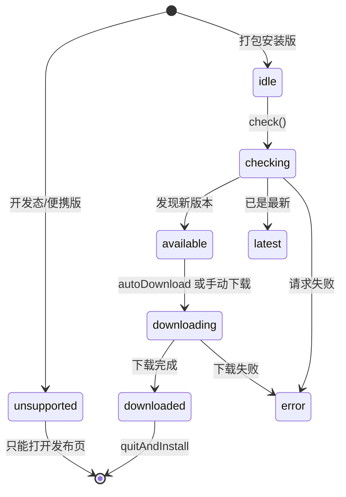

# 02 · 主进程模块详解

主进程位于 [src/main](../src/main)，负责窗口、托盘、快捷键、数据持久化、系统交互与自动更新。

## 0. 模块总表

| 模块 | 职责 | 对外关键导出 |
| --- | --- | --- |
| [index.ts](../src/main/index.ts) | 生命周期、单实例、启动编排 | 无（副作用入口） |
| [window.ts](../src/main/window.ts) | 悬浮窗创建、显示/隐藏、位置持久化 | `createMainWindow`、`toggleWindow`、`showWindow`、`getWindow`、`lockAutoHide`、`applyAlwaysOnTop`、`flushBounds`、`setQuitting` |
| [store.ts](../src/main/store.ts) | JSON 持久化、防抖写、原子替换 | `getData`、`mutate`、`save`、`replaceData`、`flushNow`、`dataFile` |
| [paths.ts](../src/main/paths.ts) | 开发态/打包态资源路径 | `resourcesDir`、`trayIconPath`、`appIconPath` |
| [ipc.ts](../src/main/ipc.ts) | IPC 注册、统一错误包装 | `registerIpc` |
| [actions.ts](../src/main/actions.ts) | 业务动作中心 | `buildState`、`pushState`、`addItem`、`addPaths`、`updateItem(s)`、`removeItem(s)`、`openItem(s)`、分组/设置/对话框/菜单/图标 |
| [tray.ts](../src/main/tray.ts) | 托盘图标与菜单 | `createTray`、`refreshTrayMenu` |
| [hotkey.ts](../src/main/hotkey.ts) | 全局快捷键 | `registerHotkey`、`unregisterHotkey`、`bootstrapHotkey`、`getActiveHotkey` |
| [updater.ts](../src/main/updater.ts) | 自动更新状态机 | `initUpdater`、`getUpdateState`、`checkForUpdate`、`downloadUpdate`、`installUpdate`、`applyUpdateSettings`、`disposeUpdater` |
| [login-item.ts](../src/main/login-item.ts) | 开机自启动 | `applyLaunchAtLogin` |
| [launch-env.ts](../src/main/launch-env.ts) | 清理继承环境变量 | `sanitizeInheritedEnv` |
| [win-icon.ts](../src/main/win-icon.ts) | PE/ICO 图标提取 | `extractIcon` |
| [url-icon.ts](../src/main/url-icon.ts) | `.url` 图标来源解析 | `splitIconLocation`、`urlIconSource` |

---

## 1. index.ts —— 应用入口

文件：[src/main/index.ts](../src/main/index.ts)

### 常量

| 名称 | 值 | 用途 |
| --- | --- | --- |
| `APP_ID` | `com.tomcato.desk-box` | `app.setAppUserModelId`，Windows 通知/任务栏身份 |
| `RELEASE_PAGE` | GitHub `releases/latest` | 托盘与更新页的落地地址 |

### 生命周期要点

| 事件/步骤 | 行为 |
| --- | --- |
| 模块加载 | 立即 `sanitizeInheritedEnv()`，清掉启动器注入的环境 |
| 单实例 | `requestSingleInstanceLock()` 失败则 `app.quit()` |
| `second-instance` | `showWindow()` 唤醒已有窗口 |
| `whenReady` | 自启项校正 → 注册 IPC → 建窗 → 托盘 → 快捷键 → 更新器 |
| `activate`（macOS） | 点击 Dock 图标重新显示窗口 |
| `before-quit` | 标记退出、落盘窗口位置与数据、注销快捷键、销毁更新器 |
| `window-all-closed` | 空实现，保持托盘常驻 |

更新器初始化时通过回调读取实时设置：

```ts
initUpdater({
  getAutoCheck: () => getData().settings.autoCheckUpdate,
  getAutoDownload: () => getData().settings.autoDownloadUpdate,
  onChange: (state) => win.webContents.send(IPC.updateChanged, state),
  releasePage: RELEASE_PAGE
})
```

---

## 2. window.ts —— 悬浮窗

文件：[src/main/window.ts](../src/main/window.ts)

### 窗口配置

```ts
new BrowserWindow({
  frame: false,
  transparent: true,
  backgroundColor: '#00000000',
  hasShadow: false,        // 系统阴影在透明边缘会留灰边
  skipTaskbar: true,
  resizable: true,
  maximizable: false,
  fullscreenable: false,
  minWidth: 340,
  minHeight: 420,
  webPreferences: {
    preload: '../preload/index.js',
    sandbox: false,
    contextIsolation: true,
    nodeIntegration: false,
    spellcheck: false,
    backgroundThrottling: false
  }
})
```

### 关键函数

| 函数 | 说明 |
| --- | --- |
| `createMainWindow(): BrowserWindow` | 读取持久化尺寸，做屏幕可见性校验，创建窗口并加载 URL/文件 |
| `toggleWindow(forceShow?)` | 按当前可见性切换显示/隐藏 |
| `showWindow()` | 强制显示并聚焦 |
| `applyAlwaysOnTop(value)` | 设置 `setAlwaysOnTop(value, 'floating')` |
| `lockAutoHide(): () => void` | 引用计数锁，对话框/菜单期间禁止失焦隐藏；返回释放函数 |
| `flushBounds()` | 退出前取消防抖并立即写窗口位置 |
| `setQuitting(value)` / `isQuitting()` | 供 `close` 事件判断是否真正退出 |
| `getWindow()` | 返回当前窗口或 `null` |

### 位置恢复逻辑

- 最小尺寸夹紧：宽 ≥ 340，高 ≥ 420。
- `isOnScreen(x, y, w, h)` 要求与任一显示器工作区重叠 **宽 > 120 且 高 > 80**，否则视为换屏/改分辨率，回退到默认位置。
- 默认位置：主屏工作区右侧偏上（距右 28px，垂直 32%）。
- `move` / `resize` 事件 400ms 防抖后写盘。

### 透明窗口的显示兜底

Windows 上透明窗口的 `ready-to-show` 可能永远不触发。因此同时挂三条路径，谁先来算谁：

```ts
mainWindow.once('ready-to-show', reveal)
mainWindow.webContents.once('did-finish-load', reveal)
const revealFallback = setTimeout(reveal, 1200)
```

### 关闭与失焦

- `close`：非退出状态下 `preventDefault()` + `hide()`，即“关闭 = 收进托盘”。
- `blur`：仅当 `settings.hideOnBlur` 为真且 DevTools 未打开时隐藏；`autoHideLocks > 0` 时跳过。

---

## 3. store.ts —— 持久化

文件：[src/main/store.ts](../src/main/store.ts)

### 数据结构与路径

- 文件：`app.getPath('userData')/desk-box.json`
- 内存缓存 `cache: AppData | null`，进程内只读一次磁盘。

### 函数

| 函数 | 说明 |
| --- | --- |
| `dataFile()` | 返回数据文件绝对路径 |
| `getData()` | 读磁盘一次并归一化；文件损坏时先改名备份再重建默认数据 |
| `mutate(fn)` | 改缓存 + 落盘 + 返回数据（当前业务多数直接 `getData` 后 `save`） |
| `save(data, immediate?)` | 默认 200ms 防抖；`immediate` 立即写 |
| `replaceData(next)` | 导入备份时整体替换并立即写 |
| `flushNow()` | 退出前强制写 |
| `writeNow(data)` | 写 `.tmp` 后 `renameSync` 覆盖，保证原子性 |

### 损坏恢复

```ts
try {
  JSON.parse(readFileSync(file, 'utf8'))
} catch {
  renameSync(file, `${file}.broken-${Date.now()}`)
  cache = createDefaultData()
}
```

原则：**宁可多留一个 `.broken` 文件，也不直接覆盖用户几个月的数据。**

---

## 4. paths.ts —— 资源路径

文件：[src/main/paths.ts](../src/main/paths.ts)

```ts
resourcesDir() =
  app.isPackaged
    ? join(process.resourcesPath, 'assets')
    : join(app.getAppPath(), 'resources')
```

打包时由 `electron-builder.yml` 的 `extraResources` 把 `resources/` 复制到 `assets/`。  
`trayIconPath()` → `tray/tray.png`；`appIconPath()` → `icon.png`。

---

## 5. ipc.ts —— IPC 注册

文件：[src/main/ipc.ts](../src/main/ipc.ts)

### 统一包装 `withState`

```ts
type TaskOutcome = string | void | { message?: string; cancelled?: boolean }

async function withState(task): Promise<ActionResult>
```

- 任务可返回字符串（成功提示）或对象（`message` / `cancelled`）。
- 任何异常都变成 `ok: false`，避免渲染层收到 unhandled rejection。
- 无论成功失败都附带最新 `buildState()`。

### 通道类型

| 注册方式 | 适用场景 | 通道 |
| --- | --- | --- |
| `ipcMain.handle` | 有返回值的请求 | 绝大多数 |
| `ipcMain.on` | 必须同步触发 | `item:menu`、`item:menu-many`、`item:drag` |

右键菜单与拖拽必须同步：异步往返会错过弹窗时机、丢失拖拽上下文。

完整的通道表见 [05-ipc-reference.md](./05-ipc-reference.md)。

---

## 6. actions.ts —— 业务中心

文件：[src/main/actions.ts](../src/main/actions.ts)，约 950 行，是主进程最核心的模块。

### 6.1 状态构建

| 函数 | 说明 |
| --- | --- |
| `buildState(): AppState` | 派生 `ext` / `exists` / `linkDir`，按 pinned → order → createdAt 排序，附 `activeHotkey` / `platform` / `version` |
| `pushState()` | 向窗口发送 `state:changed` |
| `findItem(id)` | 在缓存中查找条目 |

排序规则：

```ts
items.sort((a, b) => {
  if (a.pinned !== b.pinned) return a.pinned ? -1 : 1
  if (a.order !== b.order) return a.order - b.order
  return b.createdAt - a.createdAt
})
```

### 6.2 新增

| 函数 | 说明 |
| --- | --- |
| `addPaths(paths, groupId?)` | 批量收纳本地路径；返回 `{added, duplicated, skipped}` |
| `describeAddPaths(outcome)` | 把结果翻译成人话，区分“重复 / 路径失效 / 部分失败” |
| `addItem(input)` | 新增单条（文件、文件夹、链接、文本） |
| `displayName(target)` | 展示名；`.lnk` 去后缀，其他扩展名保留 |
| `defaultTitle(kind, target)` | 文本取首行 24 字，链接取域名，文件取显示名 |
| `nextTopOrder(items)` | 新条目位次 = 当前最小值 - 1，稳定置顶 |

`addPaths` 的行为细节：

- `statSync` 判断文件/文件夹；失败计入 `skipped`，不留死链。
- 同 `target` 已存在时**不新增**，只把它挪到当前分组并计入 `duplicated`。
- 目标分组不存在或未传时落到 `groups[0]`。

### 6.3 修改

| 函数 | 说明 |
| --- | --- |
| `applyItemPatch(groups, item, patch)` | 单条/批量共用的字段应用逻辑，返回是否真的改变 |
| `updateItem(id, patch)` | 单条更新 |
| `updateItems(ids, patch)` | 批量更新，返回真正被改到的条数，只落一次盘 |
| `markOpened(id)` | `lastOpenedAt = now`、`openCount += 1` |
| `reorderItems(ids)` | 手动排序的“座位”算法，见下文 |
| `patchSettings(patch)` | 设置更新 + 副作用（置顶/自启/快捷键/更新器） |

`applyItemPatch` 只接受四个字段：

| 字段 | 校验 |
| --- | --- |
| `title` | 非空字符串，trim 后与原值不同才改 |
| `note` | 字符串且不同才改 |
| `pinned` | 布尔且不同才改 |
| `groupId` | 必须是现存分组且不同才改 |

`patchSettings` 的兜底：

- `opacity` 经 `clampOpacity` 夹到 `0.78 ~ 1`。
- 非法 `theme` / `sortBy` 直接删除该字段，不落盘。
- `alwaysOnTop` → `applyAlwaysOnTop`。
- `launchAtLogin` → `applyLaunchAtLogin`。
- `hotkey` 变化 → `registerHotkey`。
- `autoCheckUpdate` / `autoDownloadUpdate` → `applyUpdateSettings`。

### 6.4 打开与系统操作

| 函数 | 说明 |
| --- | --- |
| `openItem(id): Promise<string \| null>` | 文本 → 写剪贴板；链接 → `shell.openExternal`；文件/文件夹 → `shell.openPath`；路径失效返回错误文案 |
| `revealItem(id)` | `shell.showItemInFolder` |
| `copyItemTarget(id)` | 复制 `target` 到剪贴板 |
| `startDragItem(id)` | 原生拖出；仅文件/文件夹，图标用应用图标缩放 48px |

`startDragItem` 的取舍：Electron 要求拖拽图标同步可得，而逐个文件取系统图标是异步的，赶不上 `dragstart` 这一帧，所以统一用应用图标作为拖拽光标。

### 6.5 删除与批量

| 函数 | 说明 |
| --- | --- |
| `removeItem(id)` | 只删记录，不动磁盘文件 |
| `removeItems(ids)` | 批量删记录，返回实际删除数 |
| `removeItemsConfirmed(ids)` | 多于 1 条时弹原生确认框；1 条直接删；0 条返回 0 |
| `openItems(ids)` | 批量打开；文本片段跳过；每条之间 60ms 间隔 |
| `describeOpenMany(outcome)` | 汇总“已打开 / 打不开 / 跳过文本” |
| `describeBatchPatch(patch, changed)` | 固定 / 移动 / 通用更新的提示文案 |

`openItems` 的 `OpenManyOutcome`：

```ts
{ opened: number; skipped: number; failed: number; firstError: string | null }
```

文本被跳过的原因：文本的“打开”是复制到剪贴板，连点多条只会剩最后一条，容易让用户误以为全部复制了。

### 6.6 分组

| 函数 | 说明 |
| --- | --- |
| `addGroup(name)` | 空名/重名返回 false |
| `renameGroup(id, name)` | trim 后为空则忽略 |
| `removeGroup(id)` | 至少保留一个；被删分组的条目落到第一个分组；随后重编号 |
| `reorderGroups(ids)` | 传入 id 顺序优先，未出现的按原相对顺序补到末尾，统一编号 `0..n-1` |

### 6.7 对话框与导入导出

| 函数 | 说明 |
| --- | --- |
| `promptAddFiles()` | 原生多选文件，收纳后返回新增数 |
| `promptAddFolder()` | 原生多选文件夹 |
| `exportData()` | 保存对话框，导出完整 `AppData` JSON，返回路径 |
| `importData()` | 打开 JSON → `replaceData`；解析失败返回 false |
| `readClipboardText()` | 读剪贴板文本 |

所有会弹原生对话框的函数都会 `lockAutoHide()` / `release()`，防止“窗口先因失焦隐藏”。

### 6.8 原生右键菜单

| 函数 | 说明 |
| --- | --- |
| `showItemMenu(id)` | 单条菜单：打开/复制、在文件夹中显示、复制路径、固定、移动到分组、移除 |
| `showBatchMenu(ids)` | 多选菜单；只有 1 条时自动退回单条菜单 |
| `removeItemsConfirmed(ids)` | 批量移除确认框 |

菜单构建后统一 `menu.popup({ window: win, callback: release })`。

### 6.9 系统图标

| 名称 | 说明 |
| --- | --- |
| `getItemIcon(id): Promise<string \| null>` | 返回 PNG data URL；不适用时 `null` |
| `iconCache: Map<string, string \| null>` | 按路径缓存，上限 300 条，超出删最早插入项 |
| `iconSource(target, ext)` | 决定“向谁要图标”：.url 的 IconFile、.lnk 的 IconLocation+索引、否则文件本身 |
| `isShortcutToDirectory(ext, target)` | .lnk 是否指向文件夹（自定义图标时不接管） |
| `genericHash()` | 用临时空 exe 探测系统“通用占位图”的哈希 |
| `siblingIcon(path)` | exe 无图标时找同目录 ico 兜底 |

图标细节见 [06-icon-subsystem.md](./06-icon-subsystem.md)。

---

## 7. tray.ts —— 托盘

文件：[src/main/tray.ts](../src/main/tray.ts)

### 图标加载降级

1. `resources/tray/tray.png`
2. `resources/icon.png`
3. 内置 1×1 透明 PNG data URL（保证 `new Tray()` 不抛错）

统一 resize 到 16×16，避免 Windows 把 32px 缩糊。

### 菜单项

| 项 | 行为 |
| --- | --- |
| 显示收纳盒 | `toggleWindow()`，显示当前快捷键 |
| 收纳文件… | `promptAddFiles()` → `pushState()` |
| 收纳文件夹… | `promptAddFolder()` → `pushState()` |
| 收纳剪贴板内容 | 有文本才可用；`addItem({kind:'text'})` |
| 窗口置顶（勾选） | 改 settings + `pushState` + `refreshTrayMenu` |
| 开机自动启动（勾选） | 改 settings + `applyLaunchAtLogin` |
| 打开数据文件夹 | `shell.showItemInFolder(dataFile())` |
| 退出 | `app.quit()` |

**注意**：设置变化后必须调用 `refreshTrayMenu()`，否则勾选状态停在旧值。`ipc.settingsPatch` 与 `windowTogglePin` 都已处理。

左键单击 = 显示/隐藏；双击 = 强制显示。

---

## 8. hotkey.ts —— 全局快捷键

文件：[src/main/hotkey.ts](../src/main/hotkey.ts)

```ts
let active: string | null = null
```

| 函数 | 说明 |
| --- | --- |
| `registerHotkey(accelerator)` | 先 `unregisterAll()`；空串返回 false；注册失败/非法 accelerator 返回 false |
| `unregisterHotkey()` | 注销全部 |
| `bootstrapHotkey()` | 启动时按 settings 注册 |
| `getActiveHotkey()` | 实际生效的组合，失败为 `null`（界面显示“未生效”） |

`buildState()` 会把 `activeHotkey` 带给渲染层，设置页据此显示真实状态。

---

## 9. updater.ts —— 自动更新

文件：[src/main/updater.ts](../src/main/updater.ts)

### 支持判定

```ts
supportOf():
  !app.isPackaged            → 不支持（开发模式）
  PORTABLE_EXECUTABLE_DIR    → 不支持（便携版）
  否则                        → 支持
```

开发自检可用环境变量 `DESK_BOX_FAKE_UPDATE=x.y.z`：即使未打包也当作可检查，不发网络请求，直接伪造“发现新版本”。

### `UpdateController` 类

| 成员 | 说明 |
| --- | --- |
| `state: UpdateState` | 当前更新状态 |
| `supported` / `supportReason` | 是否可用及原因 |
| `wired` | 是否已挂接 electron-updater 事件（只挂一次） |
| `periodicTimer` / `startupTimer` | 6 小时周期 / 启动后 6 秒 |
| `fakeVersion` | 自检假版本号 |
| `check()` | 手动/自动检查；检查中或下载中直接忽略 |
| `download()` | 仅在 `available` 时下载 |
| `install()` | 仅在 `downloaded` 时 `quitAndInstall()` |
| `openReleasePage()` | 打开 GitHub Release |
| `scheduleStartupCheck()` | 启动延迟检查 |
| `startPeriodicCheck()` | 常驻周期检查 |
| `applySettings()` | 同步 `autoDownload`，若已 available 则立即下载 |
| `dispose()` | 清理定时器 |
| `wire()` | 首次真正需要时挂接事件 |

### 状态机



### 事件映射

| electron-updater 事件 | 状态 |
| --- | --- |
| `checking-for-update` | `checking` |
| `update-available` | `available`；若 `autoDownload` 则 `downloading` |
| `update-not-available` | `latest` |
| `download-progress` | `downloading` + `percent` |
| `update-downloaded` | `downloaded` + `percent: 100` |
| `error` | `error` + 中文原因 |

### 错误文案

`describeError` 把英文错误归类为：网络不可达 / 缺少 `app-update.yml` / 更新源无版本 / 访问受限 / 截断原文。

### 单例导出

`initUpdater` 创建唯一控制器；其余导出（`getUpdateState` / `checkForUpdate` / `downloadUpdate` / `installUpdate` / `openReleasePage` / `applyUpdateSettings` / `disposeUpdater`）都是薄封装。

---

## 10. login-item.ts —— 开机自启

文件：[src/main/login-item.ts](../src/main/login-item.ts)

```ts
export function applyLaunchAtLogin(enabled: boolean): void
```

| 形态 | 调用 |
| --- | --- |
| 安装版（NSIS） | `setLoginItemSettings({ openAtLogin: enabled })` |
| 便携版（portable） | 额外传 `path: process.env.PORTABLE_EXECUTABLE_FILE` |
| 开发版 | 额外传 `path: process.execPath`、`args: [app.getAppPath()]`，且仅当 `out/renderer/index.html` 存在时才注册 |

便携版的 exe 运行在 electron-builder 的临时解压目录里，退出即被清理；`process.execPath` 指向那里，注册出去的开机项下次启动必然失效。便携版注入的 `PORTABLE_EXECUTABLE_FILE` 才是用户手里那个真实 exe，必须用它注册。

开发态必须带应用目录参数，否则注册表里只有一个裸 `electron.exe`，开机后会弹 Electron 欢迎页而不是应用。但登录项拉起时没有 `ELECTRON_RENDERER_URL`，窗口只能加载 `out/renderer/index.html`（见 [window.ts](../src/main/window.ts)），所以未构建过时干脆不注册，并顺手清掉遗留项，避免开机只开出一个空窗口。无权限环境异常静默失败。

---

## 11. launch-env.ts —— 环境清理

文件：[src/main/launch-env.ts](../src/main/launch-env.ts)

被清理的变量：

| 变量 | 风险 |
| --- | --- |
| `ELECTRON_RUN_AS_NODE` | 子进程退化成普通 Node，Electron 应用开不出窗口 |
| `NODE_OPTIONS` | 注入别人的 shim 到所有子进程 |
| `NODE_ENV` | dev 下是 `development`，子进程会误走开发/调试分支 |
| `NODE_PATH` | 全局模块搜索路径指向启动者的依赖 |
| `NODE_EXTRA_CA_CERTS` | 继承启动者的证书链 |
| `ELECTRON_NO_ASAR` | 打包应用找不到资源，白屏 |
| `ELECTRON_RENDERER_URL` | dev 下 electron-vite 注入的页面地址；其它 electron-vite 应用会误当自己的页面，白屏 |
| `ELECTRON_ENABLE_LOGGING` / `ELECTRON_LOG_FILE` / `ELECTRON_DEFAULT_ERROR_MODE` | 多余日志/错误框 |
| `WORKBUDDY_*` / `CODEBUDDY_*` / `CLAUDE_*` | 子进程误判自己的启动方式，典型表现为白屏 |

`ELECTRON_RENDERER_URL` 会在清理前先存进 `getDevRendererUrl()`，`window.ts` 用它加载 dev server，所以清理不影响收纳盒自己的窗口。

只清理 `process.env`，影响之后新建的子进程；应用自身已经启动，不受影响。

---

## 12. win-icon.ts 与 url-icon.ts

- [win-icon.ts](../src/main/win-icon.ts)：纯 JS 解析 ICO 容器与 PE 资源，支持 PNG 帧、DIB 帧（含 AND 掩码），按 `GROUP_ICON` 与索引选帧。
- [url-icon.ts](../src/main/url-icon.ts)：解析 `.url` 文本中的 `IconFile` / `IconIndex`，支持环境变量、相对路径、ANSI/GBK/UTF-16 编码，并可按 Steam appid 回查 librarycache。

详见 [06-icon-subsystem.md](./06-icon-subsystem.md)。

---

## 13. 主进程易踩坑清单

| 场景 | 现象 | 处理 |
| --- | --- | --- |
| 透明窗口 | 进程活着但看不到窗口 | 三重 reveal + 1200ms 兜底 |
| 失焦自动收起 | 对话框尚未弹出窗口先消失 | `lockAutoHide` 引用计数 |
| 托盘勾选状态 | 设置改了但菜单还是旧值 | 改完调用 `refreshTrayMenu()` |
| 关闭窗口 | 应用直接退出 | `close` 事件 `preventDefault` + `hide` |
| 数据文件损坏 | 启动即空 | 备份 `.broken-*` 后重建默认数据 |
| 开发态自启 | 开机弹 Electron 欢迎页或空窗口 | `login-item.ts` 带应用目录参数，且确认有渲染产物才注册 |
| 便携版自启 | 启动项指向临时解压目录，开机拉不起应用 | 用 `PORTABLE_EXECUTABLE_FILE` 注册真实 exe |
| 从盒子打开应用白屏 | 子进程继承宿主环境 | `launch-env.ts` 启动即清理 |
| 图标索引 | 所有快捷方式同一张白纸 | 自研 PE/ICO 解析，保留 `IconLocation` 索引 |

下一步阅读：[03-renderer.md](./03-renderer.md)。
