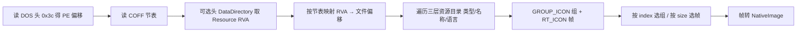

# 06 · 图标子系统

desk-box 的图标分两套：

| 套件 | 适用范围 | 实现位置 |
| --- | --- | --- |
| 矢量图标 | 绝大多数条目（文档、图片、链接、文本、文件夹、失效项） | [ItemGlyph.tsx](../src/renderer/src/components/ItemGlyph.tsx) |
| 系统真实图标 | `.lnk` / `.exe` / `.url` / `.ico` | [win-icon.ts](../src/main/win-icon.ts)、[url-icon.ts](../src/main/url-icon.ts)、[actions.ts](../src/main/actions.ts) |

判断入口：

```ts
// src/shared/icons.ts
export const REAL_ICON_EXTS = ['lnk', 'exe', 'url', 'ico']
export const hasRealIcon = (ext: string): boolean => REAL_ICON_EXTS.includes(ext)
```

为什么只对这四类取系统图标：普通文档/图片的系统图标都是同一张白纸，信息量为零；而每个文件都去问一次 shell 会明显拖慢滚动。

---

## 1. 渲染链路

```mermaid
sequenceDiagram
  participant Card as ItemCard
  participant Hook as useRealIcon
  participant Preload
  participant Main as actions.getItemIcon
  participant Parser as win-icon / url-icon
  Card->>Hook: target + ext + kind
  alt 非 lnk/exe/url/ico 或路径失效
    Hook-->>Card: null → ItemGlyph 矢量图
  else 命中
    Hook->>Hook: 模块级 Map 查缓存
    Hook->>Preload: getItemIcon(id)
    Preload->>Main: invoke('item:icon')
    Main->>Main: 主进程 Map 查缓存
    Main->>Parser: 解析图标源并提取
    Parser-->>Main: NativeImage
    Main->>Main: resize 64 + toDataURL
    Main-->>Hook: data:image/png;base64,...
    Hook-->>Card: 显示 
  end
```

### 渲染层缓存

[useRealIcon.ts](../src/renderer/src/components/useRealIcon.ts)：

- 模块级 `Map<string, string | null>`，键是 `target`。
- 只对 `exists && !linkDir && (kind === 'file' || kind === 'folder') && hasRealIcon(ext)` 发请求。
- 组件卸载与否不影响缓存；同一 target 全生命周期只请求一次。
- **无上限**：路径频繁变化时内存会慢慢增长（已知取舍）。

### 主进程缓存

[actions.ts](../src/main/actions.ts)：

```ts
const ICON_CACHE_LIMIT = 300
const iconCache = new Map<string, string | null>()
```

- 键是 `item.target`（不是 id，避免复制条目重复提取）。
- 命中 null 也缓存，避免反复失败重试。
- 超过 300 条删最早插入的键（Map 的插入顺序，不是严格 LRU）。

---

## 2. 图标源解析

### 2.1 `iconSource(target, ext): IconSource`

```ts
interface IconSource {
  file: string   // 从哪个文件取图
  index: number  // 取第几个图标（仅 exe/dll 有意义）
}
```

| 扩展名 | 逻辑 |
| --- | --- |
| `url` | `urlIconSource(target)`；解析失败则退回 `{ file: target, index: 0 }` |
| 非 `lnk` | `{ file: target, index: 0 }` |
| `lnk` | `shell.readShortcutLink` → 自定义 `IconLocation + IconIndex` → 目标程序第 0 个 → 退回自身 |

关键点：**索引不能丢**。桌面上“夸克网盘”用的是 `quark.exe` 的第 8 个图标，只传路径会取到第 0 个，所有快捷方式长得一样。

### 2.2 相对路径 IconLocation

`IconLocation` 常见 `shell32.dll,14` 这种相对路径，资源管理器按 `%SystemRoot%\System32` 解析：

```ts
function absoluteIconPath(file: string): string {
  if (isAbsolute(file)) return file
  const system32 = join(process.env.SystemRoot || 'C:\\Windows', 'System32', file)
  return existsSync(system32) ? system32 : file
}
```

直接 `existsSync('shell32.dll')` 永远为假。

### 2.3 `.url` 解析（url-icon.ts）

`.url` 是文本文件，图标写在：

```ini
[InternetShortcut]
URL=https://example.com
IconFile=C:\path\to\icon.ico
IconIndex=0
```

解析步骤：

| 步骤 | 说明 |
| --- | --- |
| 读文本 | UTF-8 / UTF-16LE（BOM）/ ANSI（GBK 常见）依次尝试 |
| 取 `IconFile` | 支持带引号、逗号后缀 `file,index` |
| 取 `IconIndex` | 仅当 `IconFile` 没带逗号时使用 |
| 编号为负 | 视为 0（资源管理器把负数当资源 ID，这里无法解析） |
| 展开环境变量 | `%SystemRoot%`、`%ProgramFiles%` 等 |
| 相对路径 | 相对 `.url` 文件所在目录 |
| 文件不存在 | 尝试 `steamLibraryIcon` |

### 2.4 Steam 库缓存兜底

Steam 快捷方式的 `IconFile` 常指向 `<steam>/steam/games/<hash>.ico`，换库/重装会清掉。  
`steamLibraryIcon(url, iconFile)`：

1. 从 `steam://rungameid/<appid>` 提取 appid。
2. 校验路径形如 `<steam>/steam/games/xxx.ico`（往上三层是 Steam 根）。
3. 在 `appcache/librarycache/<appid>_icon.jpg` 找官方图。

---

## 3. PE / ICO 提取（win-icon.ts）

原生 `app.getFileIcon(path)` 有两个硬伤：

1. 只认“文件 → 索引 0”，`IconLocation` 的索引被丢弃；
2. `.lnk` 会得到系统画的“白纸 + 蓝箭头”。

因此 desk-box 自己解析：

```ts
export function extractIcon(file: string, index = 0, size = 64): NativeImage | null
```

### 3.1 输入判定

| 输入 | 处理 |
| --- | --- |
| `.ico`（`00 00 01 00`） | 解析 ICO 目录，选最接近目标尺寸的帧 |
| PE（MZ） | 解析资源节 `RT_GROUP_ICON(14)` 与 `RT_ICON(3)` |
| 其他/失败 | 返回 `null`，由上层降级 |

### 3.2 PE 解析步骤



支持的帧格式：

| 格式 | 判定 | 解码 |
| --- | --- | --- |
| PNG 帧 | `89 50 4E 47` | `nativeImage.createFromBuffer` |
| DIB 帧 | 无 PNG magic | 自写 `dibToBitmap`：BGR/RGB、32/24/8/4 位、1 位 + AND 掩码 |
| 8 位以下 | 调色板 | 读颜色表 |
| 透明 | AND 掩码 | 0 表示透明 |

### 3.3 图标分组策略（`iconFromPE`）

exe 里的 `RT_ICON` 帧可能被 `GROUP_ICON` 引用，也可能是“孤儿帧”。

1. 收集所有被组引用的帧 id。
2. 孤儿帧按“尺寸簇”聚合（相邻尺寸连续 → 视为同一图标的多个尺寸）。
3. 有 `GROUP_ICON`：按 `nameId` 排序得到稳定顺序，`index` 选第几组。
4. 完全无 `GROUP_ICON`：所有帧按簇切分，每个簇算一个图标。
5. `index` 越界时夹到最后一个，不返回 null。

簇的切分依据（`clusterIconFrames`）：按 id 排序后，尺寸从大变小时开始新簇；出现 16×16 通常意味着下一个图标的开始。

### 3.4 尺寸选择（`selectFrame`）

```ts
1. 精确匹配目标尺寸 → 直接用
2. 否则取 ≤ target 中最大的
3. 都太大 → 取最小的
```

例如目标 64：有 256/48/32/16 时选 48；之后统一 `resize(64)`，兼顾 2x 屏与 data URL 体积。

### 3.5 `.dll` 例外

`shell32.dll` 等系统资源库不遵循 `RT_GROUP_ICON`，图标由系统内部映射。因此：

```ts
let image = /\.dll$/i.test(source.file)
  ? null
  : extractIcon(source.file, source.index, ICON_SIZE)
```

之后走 shell 兜底。

---

## 4. `getItemIcon` 完整管线

文件：[actions.ts](../src/main/actions.ts) 末尾。

```text
1. 查 item，不存在返回 null
2. 非 path 类（link/text）返回 null
3. 路径不存在返回 null
4. 扩展名不在 REAL_ICON_EXTS 且不是 .lnk → 返回 null
5. 查 iconCache（target）
6. iconSource() 决定向谁要图
7. 自研 extractIcon（.dll 跳过）
8. 失败且源是图片（ico/png/jpg/bmp）→ nativeImage.createFromPath
9. 失败或得到“系统通用占位图” → siblingIcon()
10. 仍失败 → app.getFileIcon(source.file)（shell 兜底）
11. 仍然空 → null
12. 宽 > 64 → resize
13. toDataURL('image/png')
14. 写入缓存（null 也缓存）
```

### 4.1 通用占位图识别

系统对没有图标资源的 exe 会画一张固定占位图。不同 Windows 版本/DPI 下这张图不同，所以不能硬编码尺寸。

做法：写一个内容为 `desk-box icon probe` 的临时 `.exe`，向系统要一次图标并计算 SHA-1；之后所有图标的 SHA-1 与它相同就判定“等于没图标”。临时文件只用于探测，探测后删除。

为什么用哈希而不是尺寸：系统占位图在不同 DPI 下尺寸会变，但同一台机器上内容稳定。

### 4.2 同目录 ico 兜底

很多绿色软件 exe 本身没有图标资源，但安装目录里有官方 logo。`siblingIcon` 按顺序查找：

| 顺序 | 路径 |
| --- | --- |
| 1 | `<dir>/<同名>.ico` |
| 2 | `<dir>/icon.ico` |
| 3 | `<dir>/app.ico` |
| 4 | `<dir>/resources/icon.ico` |
| 5 | `<dir>/resources/app.ico` |
| 6 | 目录里唯一的 `.ico`（多个则不猜） |

品牌 ico 常见 256×256，统一缩到 64 再转 data URL，避免几十 MB 的 base64 拖慢界面。

---

## 5. 渲染层矢量图标（ItemGlyph）

文件：[ItemGlyph.tsx](../src/renderer/src/components/ItemGlyph.tsx)

| 类型 | 视觉 | 说明 |
| --- | --- | --- |
| `link` | 圆角色块 + 域名首字母 | 颜色由 target 哈希稳定选取 |
| `text` | 引号色块 | — |
| `file` | 纸张 + 折角 + 类型标记 | 标记按扩展名分类 |
| `folder` | 背板 + 前片 | 双层文件夹造型 |
| 文件夹 `.lnk` | 矢量文件夹 + “捷径”小圆徽 | 保留“这是快捷方式”的信号 |
| `exists === false` | 虚线轮廓 + 感叹号 | 路径失效 |
| `compact` | 尺寸缩小 | 与卡片密度联动 |

扩展名分类（`EXT_KINDS`）：

| 分类 | 常见扩展名 |
| --- | --- |
| `image` | png/jpg/jpeg/gif/webp/svg/bmp/ico/avif |
| `doc` | doc/docx/pdf/txt/md/rtf |
| `sheet` | xls/xlsx/csv/numbers |
| `code` | js/ts/tsx/jsx/py/go/rs/java/c/cpp/json/html/css |
| `archive` | zip/rar/7z/tar/gz |
| `media` | mp4/mov/avi/mkv/mp3/wav/flac |
| `app` | exe/msi/app/dmg |
| 默认 | `file` |

---

## 6. 图标常见问题与排查

| 现象 | 原因 | 处理 |
| --- | --- | --- |
| 快捷方式全是白纸+箭头 | 直接 `getFileIcon('.lnk')` | 必须 `readShortcutLink` 后带索引取 |
| 不同快捷方式同一图标 | 丢了 `IconIndex` | `splitIconLocation` 保留索引 |
| 系统 DLL 图标取不到 | `.dll` 没有 RT_GROUP_ICON | 跳过自研解析，走 shell |
| 绿色软件无图标 | exe 无资源 | `siblingIcon` 找同目录 ico |
| 换 exe 图标后没变化 | 主进程缓存按路径 | 重启应用 |
| 图标是白纸占位图 | 系统通用图 | `genericHash` 识别后降级 |
| Steam 图标丢失 | librarycache 被清 | 需要重新跑一次 Steam 或手动设图标 |
| 大图标导致卡顿 | 256×256 data URL | 统一 resize 到 64 |

---

## 7. 扩展点

| 需求 | 修改点 |
| --- | --- |
| 支持更多真实图标类型 | `shared/icons.ts` 的 `REAL_ICON_EXTS` + `getItemIcon` 判定 + `useRealIcon` 条件 |
| 支持 macOS 图标 | 当前 `win-icon.ts` 只解析 PE/ICO；macOS 应走 `app.getFileIcon` 或 `.icns` 解析 |
| 增加矢量类型 | `ItemGlyph.tsx` 的 `EXT_KINDS` 与 `Mark` |
| 调整缓存容量 | `ICON_CACHE_LIMIT` 与渲染层 Map 策略 |
| 支持高 DPI 更大图标 | `ICON_SIZE`（注意 data URL 体积） |
| 支持资源 ID 负索引 | `url-icon.ts` 目前负数归 0，需要 PE 资源按 ID 查找 |

下一步阅读：[07-build-release.md](./07-build-release.md)。
