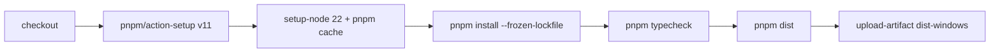

# 07 · 构建、运行与发布

## 1. 环境要求

| 项 | 版本/说明 |
| --- | --- |
| Node.js | 22（CI 固定 22；最低建议 20+） |
| 包管理器 | pnpm 11（CI 使用 `pnpm/action-setup@v4`，`version: 11`） |
| 操作系统 | Windows 主要开发/打包；macOS 打包未签名 |
| 网络 | 国内环境依赖 npmmirror 镜像；CI 直连 GitHub |

```bash
pnpm install
pnpm dev
```

`pnpm install` 会触发 `postinstall` → `scripts/ensure-electron.mjs`：检查 `node_modules/electron/path.txt` 与 `dist/version`，缺失则按镜像重新下载。下载失败不会让安装失败，但会打印补救命令：

```bash
node scripts/ensure-electron.mjs
```

---

## 2. 依赖

### 运行时依赖

| 包 | 版本 | 用途 |
| --- | --- | --- |
| `electron-updater` | `^6.8.11` | GitHub Release 自动更新 |
| `pinyin-pro` | `^3.29.5` | 中文拼音首字母搜索 |

### 开发依赖

| 包 | 版本 | 用途 |
| --- | --- | --- |
| `electron` | `43.3.0` | 运行时（固定精确版本） |
| `electron-vite` | `^5.0.0` | 三段式构建与 dev server |
| `vite` | `^8.2.0` | 底层打包器 |
| `@vitejs/plugin-react` | `^6.0.5` | React JSX/Fast Refresh |
| `react` / `react-dom` | `^19.2.8` | 界面 |
| `typescript` | `^5.9.3` | 类型检查 |
| `electron-builder` | `^26.15.3` | 打包与发布 |
| `@types/node` | `^22.10.5` | Node 类型 |
| `@types/react` / `@types/react-dom` | 19.x | React 类型 |

### pnpm 特殊配置

[pnpm-workspace.yaml](../pnpm-workspace.yaml)：

```yaml
allowBuilds:
  electron: true
  esbuild: true
  electron-builder: true
  electron-winstaller: true

overrides:
  app-builder-lib>@electron/get: 3.1.0
```

- `allowBuilds`：pnpm 10+ 只认这个白名单，不再读 `package.json` 的 `onlyBuiltDependencies`。
- `overrides`：electron-builder 26 解包 Electron 时需要 `@electron/get` 3.1.0 的 `ElectronDownloadCacheMode`，锁在 3.0.0 会报 `ReadWrite` undefined。

---

## 3. npm scripts

文件：[package.json](../package.json)

| 脚本 | 实际命令 | 说明 |
| --- | --- | --- |
| `pnpm gen:icons` | `node scripts/gen-icons.mjs` | 生成 PNG/ICO/ICNS/托盘图标 |
| `pnpm postinstall` | `node scripts/ensure-electron.mjs` | 安装后确保 Electron 二进制 |
| `pnpm dev` | `node scripts/electron-run.mjs dev` | 开发模式 + HMR |
| `pnpm build` | `electron-vite build` | 产出 `out/` |
| `pnpm preview` | `node scripts/electron-run.mjs preview` | 运行构建产物 |
| `pnpm typecheck` | 两个 tsc 串行 | 主/预加载 + 渲染层 |
| `pnpm dist` | `electron-vite build && node scripts/dist.mjs --publish never` | 本地打包，禁止隐式发布 |

### 为什么要包一层启动脚本

`scripts/electron-run.mjs` 的唯一职责：删除 `ELECTRON_RUN_AS_NODE`。  
只要有这个变量，`electron.exe` 就退化成普通 Node，主进程 `require('electron')` 拿到 npm 的“路径转发壳”，启动即崩且报错毫无线索。

`scripts/dist.mjs` 的职责：

1. 注入 `ELECTRON_MIRROR` 与 `ELECTRON_BUILDER_BINARIES_MIRROR`（默认 npmmirror）。
2. 用 `process.execPath` 直接拉起 electron-builder 的 JS CLI，绕过 `.cmd`/shell（Windows 上避免命令行转义与证书吊销问题）。
3. 固定末尾 `--publish never`，防止 CI/tag 环境下 electron-builder 隐式发布。

本地打包时追加参数：

```bash
pnpm dist -- --win
pnpm dist -- --mac
```

注意 `pnpm dist` 已带 `--publish never`，追加参数是传给 electron-builder 的目标平台。

---

## 4. electron-vite 配置

文件：[electron.vite.config.ts](../electron.vite.config.ts)

### 4.1 三段构建

| 段 | 入口 | 输出 |
| --- | --- | --- |
| main | `src/main/index.ts` | `out/main/index.js` |
| preload | `src/preload/index.ts` | `out/preload/index.js` |
| renderer | `src/renderer/index.html` | `out/renderer/` |

`package.json` 的 `main` 指向 `./out/main/index.js`。

### 4.2 强制 CJS 的原因

electron-vite 5 默认产出 ESM，但 Electron 的 `electron` 模块是 CJS，Node 的具名导出探测对它不生效，会报：

```text
does not provide an export named 'BrowserWindow'
```

因此 main 与 preload 都配置：

```ts
const cjsOutput = { format: 'cjs', entryFileNames: '[name].js' }
```

### 4.3 外部化 Electron 与 Node 内置模块

```ts
const nodeExternals = ['electron', ...builtinModules.flatMap((n) => [n, `node:${n}`])]
```

若不外部化，Vite 会就地解析成 `node_modules/electron` 的路径转发壳，运行时报：

```text
Electron failed to install correctly
```

`externalizeDepsPlugin()` 同时把 `dependencies`（`electron-updater`、`pinyin-pro`）外部化，运行时从 `node_modules` 解析。

### 4.4 渲染层

```ts
renderer: {
  root: 'src/renderer',
  resolve: { alias: { '@shared': 'src/shared' } },
  server: { fs: { allow: [项目根] } },
  plugins: [react()]
}
```

- `@shared` 别名让渲染层可以直接 `import type { Item } from '@shared/types'`。
- `server.fs.allow` 放宽到项目根，否则 dev server 无法读取 `src/shared`。

---

## 5. 类型检查配置

根 [tsconfig.json](../tsconfig.json) 只做 project references：

```json
{ "files": [], "references": [
  { "path": "./tsconfig.node.json" },
  { "path": "./tsconfig.web.json" }
]}
```

| 配置 | include | lib/types | 关键点 |
| --- | --- | --- | --- |
| [tsconfig.node.json](../tsconfig.node.json) | `main`、`preload`、`shared`、vite 配置 | `ES2022` + Node/electron-vite 类型 | `strict`、`noUnusedLocals`、`noUnusedParameters`、`noFallthroughCasesInSwitch` |
| [tsconfig.web.json](../tsconfig.web.json) | `renderer`、`shared` | `ES2022` + DOM + DOM.Iterable | `jsx: react-jsx`、`@shared/*` 路径映射 |

因为 `shared` 同时进入两套配置，它必须保持无 Electron/React 依赖。

---

## 6. 打包配置

文件：[electron-builder.yml](../electron-builder.yml)

### 6.1 基本信息

| 项 | 值 |
| --- | --- |
| `appId` | `com.tomcato.desk-box` |
| `productName` | 桌面收纳盒 |
| 输出目录 | `release/` |
| 打包内容 | `out/**/*`、`package.json` |
| 额外资源 | `resources/` → `assets/` |

`extraResources` 的映射与 [paths.ts](../src/main/paths.ts) 对应：

```ts
app.isPackaged
  ? join(process.resourcesPath, 'assets')
  : join(app.getAppPath(), 'resources')
```

### 6.2 Windows

| 项 | 值 |
| --- | --- |
| 图标 | `resources/icon.ico`（显式，避免 WASM 转换崩） |
| 可执行名 | `desk-box`（ASCII） |
| 目标 | `nsis` x64、`portable` x64 |
| NSIS | 非一键、非机器级、可改安装目录、桌面/开始菜单快捷方式 |
| 产物名 | `desk-box-${version}-setup.exe` / `desk-box-${version}-portable.exe` |

### 6.3 macOS

| 项 | 值 |
| --- | --- |
| 签名 | `identity: null`（无 Developer ID） |
| 图标 | `resources/icon.icns` |
| 分类 | `public.app-category.productivity` |
| 目标 | `dmg` arm64 + x64 |

### 6.4 发布源

```yaml
publish:
  provider: github
  owner: FightZhanAng
  repo: desk-box
```

electron-builder 会把这段写进包里的 `app-update.yml`，`electron-updater` 据此拉 `latest.yml`。

### 6.5 产物

```text
release/
├─ desk-box-0.3.1-setup.exe
├─ desk-box-0.3.1-setup.exe.blockmap
├─ desk-box-0.3.1-portable.exe
├─ latest.yml
├─ win-unpacked/
└─ (mac) desk-box-0.3.1-arm64.dmg / desk-box-0.3.1-x64.dmg
```

`latest.yml` 与 `.blockmap` 是更新链路的一半：前者让客户端比版本，后者支持差量下载。

---

## 7. 开发/生产加载路径

`window.ts` 按 `is.dev` 分流：

| 模式 | 加载 |
| --- | --- |
| dev | `process.env['ELECTRON_RENDERER_URL']`（electron-vite 注入） |
| 生产/preview | `join(__dirname, '../renderer/index.html')` |

因此修改渲染层代码在 dev 下会 HMR；修改主进程需重启。

---

## 8. CI 发布流程

文件：[.github/workflows/release.yml](../.github/workflows/release.yml)

### 触发

| 触发 | 行为 |
| --- | --- |
| push tag `v*` | 打包 + 发布 Release |
| `workflow_dispatch` | 只打包留档，不发布 |

### 权限与镜像

```yaml
permissions:
  contents: write
env:
  ELECTRON_MIRROR: https://github.com/electron/electron/releases/download/
  ELECTRON_BUILDER_BINARIES_MIRROR: https://github.com/electron-userland/electron-builder-binaries/releases/download/
```

CI 不用 npmmirror（那是给国内机器用的）。

### windows job



上传内容：

```text
release/*-setup.exe
release/*-portable.exe
release/latest.yml
release/*.blockmap
```

`if-no-files-found: error`：少一个直接失败，避免发出无法更新的 Release。

### release job

- 仅在 tag 构建时运行。
- `actions/checkout` 是必须的：要读 tag 的中文注释。
- 下载 artifact → 合并到 `dist/`。
- 发布前重新 fetch tag 的注解对象：

```bash
git fetch --force origin "refs/tags/${TAG}:refs/tags/${TAG}"
NOTES=$(git tag -l --format='%(contents)' "$TAG")
```

- `gh release create` 上传 setup/portable/`latest.yml`/blockmap。
- 有 tag message 时用 `--notes-file`，否则 `--generate-notes`。

### 发版操作

```bash
pnpm version patch --no-git-tag-version   # 或手改 package.json
git commit -am "chore: bump 0.3.2"
git tag v0.3.2 -m "本次更新的中文说明"
git push origin main --tags
```

> `latest.yml` 里的版本来自 `package.json`，tag 只是触发与展示；两者要保持一致。

---

## 9. 图标资源生成

文件：[scripts/gen-icons.mjs](../scripts/gen-icons.mjs)

```bash
pnpm gen:icons
ICON_PREVIEW=1 pnpm gen:icons   # 额外输出 16/24/32/48 放大预览
```

生成内容：

| 文件 | 用途 |
| --- | --- |
| `resources/icon.png` | 窗口/开发态应用图标 |
| `resources/icon.ico` | Windows 打包（多尺寸） |
| `resources/icon.icns` | macOS 打包 |
| `resources/tray/tray.png` | 托盘 |

纯 Node 实现（无 sharp/canvas 依赖），修改图形后重跑即可。

---

## 10. 环境变量

| 变量 | 作用 | 默认 |
| --- | --- | --- |
| `ELECTRON_MIRROR` | Electron 二进制下载源 | `https://npmmirror.com/mirrors/electron/` |
| `ELECTRON_BUILDER_BINARIES_MIRROR` | 打包工具二进制源 | `https://npmmirror.com/mirrors/electron-builder-binaries/` |
| `ELECTRON_RUN_AS_NODE` | **必须不存在**；启动脚本会主动删除 | — |
| `DESK_BOX_FAKE_UPDATE` | 开发态伪造更新版本，用于自检更新 UI | 未设置 |
| `PORTABLE_EXECUTABLE_DIR` | electron-builder 便携版注入；用于判定“不支持应用内更新” | — |
| `PORTABLE_EXECUTABLE_FILE` | electron-builder 便携版注入；真实便携 exe 路径，用于注册开机自启 | — |
| `ELECTRON_RENDERER_URL` | electron-vite dev server 地址 | dev 注入 |
| `ICON_PREVIEW` | `gen:icons` 时输出小尺寸预览 | 未设置 |

---

## 11. 常见构建问题

| 现象 | 原因 | 解决 |
| --- | --- | --- |
| `Electron uninstall` | 43 起 electron 包无 postinstall，二进制未下载 | `node scripts/ensure-electron.mjs` |
| `does not provide an export named 'BrowserWindow'` | 主进程被构建成 ESM | 保持 `cjsOutput` |
| `Electron failed to install correctly` | `electron` 被打进 bundle | 保持 `nodeExternals` |
| 打包卡在下载 winCodeSign/nsis | GitHub 证书吊销检查 | 用 `scripts/dist.mjs` 的镜像 |
| `Cannot read properties of undefined (reading 'ReadWrite')` | `@electron/get` 3.0.0 | 保持 pnpm override 3.1.0 |
| 白屏但进程正常 | 环境继承了 `ELECTRON_RUN_AS_NODE`/`NODE_OPTIONS` | 用 `pnpm dev`；应用内 `sanitizeInheritedEnv` |
| `electron-builder` 隐式发布失败 | tag/CI 环境未带 `--publish never` | 用 `pnpm dist` |
| macOS 首开被 Gatekeeper 拦 | 未签名 | 右键打开或 `xattr -cr` |
| CI 缺 `latest.yml` | 打包失败或被过滤 | 检查 artifact 路径与 `if-no-files-found` |

---

## 12. 数据与调试路径

| 项 | 位置 |
| --- | --- |
| 用户数据 | `%APPDATA%/desk-box/desk-box.json` |
| 损坏备份 | `desk-box.json.broken-<timestamp>` |
| 开发态数据 | `--user-data-dir` 指定目录 |
| 构建产物 | `out/` |
| 打包产物 | `release/` |
| 应用资源（打包后） | `resources/assets/` |

托盘菜单「打开数据文件夹」直接定位 JSON，排查数据问题最快。

下一步阅读：[08-development-guide.md](./08-development-guide.md)。
