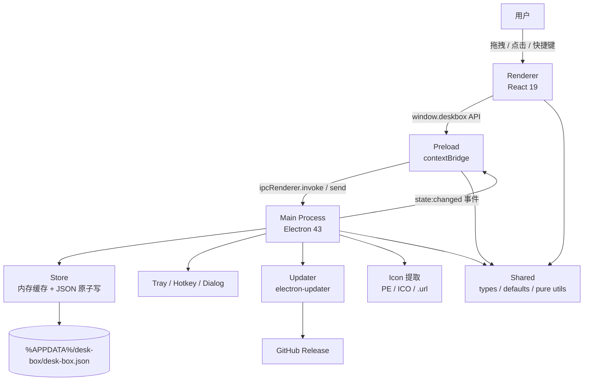

# 桌面收纳盒（desk-box）Code Wiki

> 一个常驻托盘的悬浮小抽屉：把文件、文件夹、浏览器链接和随手一段文字拖进来，按分组收好，双击即开。

本 Wiki 面向需要维护、扩展或排查这个 Electron 应用的开发者，覆盖整体架构、模块职责、关键函数、依赖关系、数据模型、IPC 契约以及构建发布方式。

---

## 1. 项目速览

| 项目 | 内容 |
| --- | --- |
| 应用名 | 桌面收纳盒（`desk-box`） |
| 版本 | `0.3.1` |
| 运行时 | Electron `43.3.0` |
| 界面 | React `19` + TypeScript `5.9` |
| 构建 | `electron-vite 5`（Vite 8） |
| 打包 | `electron-builder 26`（Windows NSIS/portable、macOS DMG） |
| 自动更新 | `electron-updater 6` + GitHub Release |
| 搜索增强 | `pinyin-pro`（拼音首字母匹配） |
| 平台 | Windows 为主，macOS 可打包（未签名） |
| 数据存储 | 单个 JSON 文件，位于 Electron `userData` 目录 |

核心产品行为：

- 无边框透明悬浮窗，可置顶、可失焦自动收起、可全局快捷键呼出。
- 收纳项分四类：`file` / `folder` / `link` / `text`。
- 分组管理、置顶、手动排序、多选批量操作、拼音首字母搜索。
- 快捷方式/可执行文件读取系统原图标，其余类型使用自绘 SVG。
- 数据原子写盘、损坏自动备份、支持 JSON 导入导出。
- 后台每 6 小时检查一次更新。

---

## 2. 架构一览



三条硬边界：

1. **渲染层不直接碰 Node/Electron**：`nodeIntegration: false`、`contextIsolation: true`，所有能力经 `preload` 暴露成 `window.deskbox`。
2. **共享层必须保持纯净**：`src/shared/**` 不允许引用 `electron` 或 `react`，以便同时通过 Node 与浏览器两套 tsconfig。
3. **所有写操作集中在主进程**：渲染层只发 IPC；主进程改内存缓存、落盘、回传最新 `AppState`。

---

## 3. 快速开始

```bash
pnpm install        # postinstall 会确保 electron 二进制就位
pnpm dev            # 开发模式（HMR）
pnpm typecheck      # 主进程/预加载 与 渲染层 分别检查
pnpm build          # 产出 out/
pnpm preview        # 运行构建产物
pnpm dist -- --win  # 打包 Windows 安装包 + 便携版
pnpm dist -- --mac  # 打包 macOS dmg（未签名）
pnpm gen:icons      # 重新生成 png / ico / icns / 托盘图标
```

更完整的构建、打包、CI 与发布流程见 [07-build-release.md](./07-build-release.md)。

---

## 4. 文档导航

| 文档 | 内容 |
| --- | --- |
| [01-architecture.md](./01-architecture.md) | 进程模型、启动时序、数据流、关键设计决策 |
| [02-main-process.md](./02-main-process.md) | 主进程 13 个模块的职责、关键类/函数、注意事项 |
| [03-renderer.md](./03-renderer.md) | React 应用状态中心、组件树、交互与拖拽逻辑 |
| [04-shared-data-model.md](./04-shared-data-model.md) | 类型定义、数据模型、持久化、迁移与排序规则 |
| [05-ipc-reference.md](./05-ipc-reference.md) | IPC 通道全集与 `DeskboxApi` 对照 |
| [06-icon-subsystem.md](./06-icon-subsystem.md) | 系统图标提取、快捷方式/.url 解析、缓存与降级 |
| [07-build-release.md](./07-build-release.md) | 构建配置、打包产物、CI、版本发布、环境变量 |
| [08-development-guide.md](./08-development-guide.md) | 开发约定、扩展点配方、已知边界与排障 |

---

## 5. 目录结构

```text
desk-box/
├─ src/
│  ├─ main/                 主进程（Node + Electron）
│  │  ├─ index.ts           应用生命周期、单实例、启动编排
│  │  ├─ window.ts          悬浮窗创建、显示/隐藏、位置持久化
│  │  ├─ tray.ts            托盘图标与菜单
│  │  ├─ hotkey.ts          全局快捷键注册
│  │  ├─ ipc.ts             IPC 通道注册与统一错误包装
│  │  ├─ actions.ts         业务动作（增删改查/打开/菜单/导入导出/图标）
│  │  ├─ store.ts           JSON 持久化（防抖 + 原子写 + 损坏备份）
│  │  ├─ paths.ts           资源目录解析（开发态/打包态）
│  │  ├─ updater.ts         electron-updater 单例与状态机
│  │  ├─ login-item.ts      开机自启动
│  │  ├─ launch-env.ts      清理继承自启动器的环境变量
│  │  ├─ win-icon.ts        PE / ICO 图标提取
│  │  └─ url-icon.ts        .url 快捷方式图标解析
│  ├─ preload/
│  │  └─ index.ts           contextBridge 暴露 DeskboxApi
│  ├─ renderer/
│  │  ├─ index.html         CSP、挂载点
│  │  └─ src/
│  │     ├─ main.tsx        React 入口
│  │     ├─ App.tsx         应用状态中心与交互编排
│  │     ├─ styles.css      四套主题与全部样式
│  │     ├─ components/     13 个组件 + 1 个 hook + 1 个图标库
│  │     └─ lib/            排序、拼音首字母、内部拖拽标记
│  └─ shared/               两端共用（无 electron/react 依赖）
│     ├─ types.ts           实体类型、设置、IPC 常量
│     ├─ api.ts             DeskboxApi 契约
│     ├─ defaults.ts        默认值、常量、数据归一化
│     ├─ format.ts          快捷键可读化
│     ├─ icons.ts           哪些扩展名使用系统图标
│     ├─ update.ts          版本比较与更新状态文案
│     └─ url.ts             URL 规范化、域名、URL 判定
├─ scripts/
│  ├─ gen-icons.mjs         纯 Node 生成 PNG/ICO/ICNS
│  ├─ electron-run.mjs      清理 ELECTRON_RUN_AS_NODE 后启动
│  ├─ ensure-electron.mjs   确保 Electron 二进制存在
│  └─ dist.mjs              注入镜像后调用 electron-builder
├─ resources/               应用图标、托盘图标
├─ .github/workflows/       Release CI
├─ electron.vite.config.ts  主/预加载/渲染三段构建配置
├─ electron-builder.yml     打包与发布配置
├─ tsconfig.node.json       主进程 + 预加载 + shared
├─ tsconfig.web.json        渲染层 + shared
└─ package.json
```

---

## 6. 关键设计决策（阅读源码前先知道）

| 决策 | 原因/收益 |
| --- | --- |
| 数据常驻内存 + 防抖原子写 | 避免高频 IO；`tmp → rename` 防止半个 JSON |
| 所有写操作返回 `ActionResult{state}` | 渲染层一次 `setState` 即可同步，不用二次查询 |
| 批量操作一次 IPC / 一次落盘 / 一次推送 | 多选二三十项时避免界面闪烁和重复写盘 |
| 「常用」是虚拟分组 `freq` | 不占用真实分组、不可删改，按 `openCount` 现算 |
| 固定项恒在最前 | `pinned` 的语义就是“别把它挪走”，任何排序都不能推翻 |
| 仅 `lnk/exe/url/ico` 取系统图标 | 图片/文档的系统图标是同款白纸，矢量图更清楚且更快 |
| 图标双层缓存 | 主进程按路径缓存（上限 300），渲染层再缓存一层 |
| 透明窗三重 reveal 兜底 | Windows 上透明窗口 `ready-to-show` 可能永不触发 |
| 原生对话框/菜单期间锁定失焦收起 | 否则窗口先失焦隐藏，对话框还没弹出来 |
| 内部拖拽使用自定义 MIME | 区分“卡片排序”和“从桌面拖文件进来”，避免误收纳 |

---

## 7. 相关链接

- 仓库：<https://github.com/FightZhanAng/desk-box>
- 发布页：<https://github.com/FightZhanAng/desk-box/releases/latest>
- 入口文件：[src/main/index.ts](../src/main/index.ts)
- 界面入口：[src/renderer/src/App.tsx](../src/renderer/src/App.tsx)
